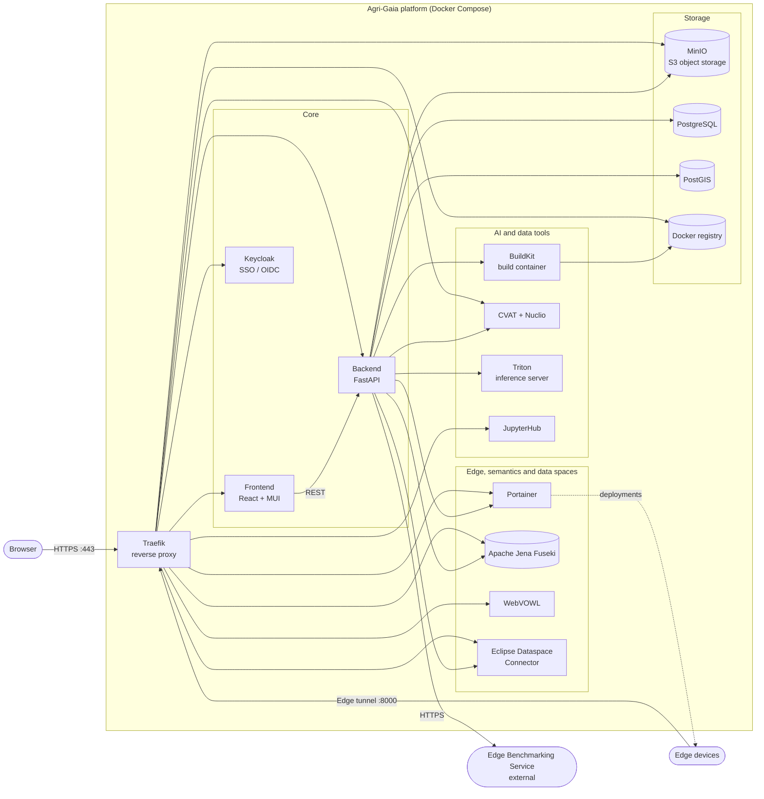

<!--
SPDX-FileCopyrightText: 2024 Osnabrück University of Applied Sciences
SPDX-FileContributor: Andreas Schliebitz
SPDX-FileContributor: Henri Graf
SPDX-FileContributor: Jonas Tüpker
SPDX-FileContributor: Lukas Hesse
SPDX-FileContributor: Maik Fruhner
SPDX-FileContributor: Prof. Dr.-Ing. Heiko Tapken
SPDX-FileContributor: Tobias Wamhof

SPDX-License-Identifier: MIT
-->

<div align="center">


# Agri-Gaia Platform

**A self-hosted platform for agricultural data and AI that covers the full lifecycle from dataset annotation and model training to deployment on edge devices.**

[](CHANGELOG.md)
[](LICENSE)
[](https://docs.docker.com/compose/)
[](https://traefik.io/)
[](https://www.keycloak.org/)
[](#-requirements)

[Getting Started](#-getting-started) ·
[Configuration](#-configuration) ·
[Edge Benchmarking](#-edge-benchmarking) ·
[Development](#-development) ·
[Production Deployment](#production-deployment) ·
[Related Repositories](#-related-repositories)

</div>

> [!NOTE]
> This is the **`edge-benchmarking`** branch. In addition to the features of `main`, it integrates an external **Edge Benchmarking Service** that measures the performance of platform models on physical edge devices (see [Edge Benchmarking](#-edge-benchmarking)). Several component versions differ from `main`; the versions listed in this README refer to this branch.

---

## 📖 Table of Contents

- [Overview](#-overview)
- [Features](#-features)
- [Architecture](#-architecture)
- [Requirements](#-requirements)
- [Getting Started](#-getting-started)
- [Configuration](#-configuration)
- [Edge Benchmarking](#-edge-benchmarking)
- [Development](#-development)
- [Testing](#-testing)
- [Project Structure](#-project-structure)
- [Related Repositories](#-related-repositories)
- [Changelog](#-changelog)
- [License](#-license)

## 🌱 Overview

The Agri-Gaia platform was created by the working group of Prof. Dr.-Ing. Heiko Tapken at Osnabrück University of Applied Sciences. It brings together established open-source components, including Keycloak, MinIO, CVAT, JupyterHub, Portainer, Apache Jena Fuseki, NVIDIA Triton and the Eclipse Dataspace Connector, behind a single sign-on and a unified web interface. This lets agricultural data scientists manage datasets, annotate them, train and export AI models, and roll them out to edge devices without leaving the platform.

The platform is deployed with **Docker Compose**. This repository contains the Compose configuration, the service customizations and the helper scripts. The web application itself lives in two submodules:

| Submodule | Path | Description |
|-----------|------|-------------|
| [agri-gaia-backend](https://github.com/hsos-ai-lab/agri-gaia-backend) | [`services/backend`](services/backend) | REST API (FastAPI) that orchestrates all platform services |
| [agri-gaia-frontend](https://github.com/hsos-ai-lab/agri-gaia-frontend) | [`services/frontend`](services/frontend) | Web client (React and Material UI) |

## ✨ Features

- **Dataset management**: upload datasets to per-user S3 buckets (MinIO), enrich them with semantic metadata, and convert label formats (CVAT, COCO, YOLO).
- **Annotation**: an integrated [CVAT](https://www.cvat.ai/) instance with [Nuclio](https://nuclio.io/) serverless functions for AI-assisted auto-annotation.
- **Model training**: build and run GPU-enabled training containers from templates (EfficientNet, Mask R-CNN, YOLOv5, YOLOv11, or your own [train container templates](https://github.com/hsos-ai-lab/agri-gaia-train-container-template)), with optional ONNX export.
- **Model inference**: batch inference with [NVIDIA Triton Inference Server](https://developer.nvidia.com/triton-inference-server) and custom [inference container images](https://github.com/hsos-ai-lab/agri-gaia-inference-container-template).
- **Edge deployment**: register edge devices and deploy models, containers and applications to them through Portainer Edge.
- **Edge benchmarking**: benchmark models on physical edge devices, compare the results and get device recommendations through an external Edge Benchmarking Service.
- **Semantic web**: an RDF triple store (Apache Jena Fuseki) with AGROVOC, GeoNames and Gaia-X ontologies, visualized with WebVOWL.
- **Data spaces**: an Eclipse Dataspace Connector (EDC) for publishing and consuming datasets, models and services in a data space.
- **Notebooks**: per-user JupyterLab environments through JupyterHub, with direct access to the user's object storage.
- **Identity and access**: single sign-on for all components through Keycloak (OpenID Connect).
- **Monitoring**: Prometheus, cAdvisor, Node Exporter and Grafana dashboards.

## 🧱 Architecture

All services run in a single Docker network. Traefik terminates TLS and routes each sub-domain of `PROJECT_BASE_URL` to its service.



### Services

The services are organized in [Compose profiles](https://docs.docker.com/compose/how-tos/profiles/). Services without a profile always start.

| Service | Image / Base | Sub-domain | Profile |
|---------|--------------|------------|---------|
| `traefik` | `traefik:v3.6` | `traefik.` | – |
| `frontend` | [`services/frontend`](services/frontend) (Node 20) | `app.` | – |
| `backend` | [`services/backend`](services/backend) (Python 3.12) | `api.` | – |
| `keycloak` | `quay.io/keycloak/keycloak:26.6.0` | `keycloak.` | – |
| `minio` | `pgsty/silo:RELEASE.2026-11-12T00-00-00Z` (MinIO fork) | `minio.`, `minio-console.` | – |
| `registry` | `registry:2` | `registry.` | – |
| `build_container` | `docker:27-dind` with BuildKit 0.15.1 | – | – |
| `jupyterhub` | `jupyterhub/jupyterhub:5.4.5` | `jupyterhub.` | – |
| `postgres_backend`, `postgres_keycloak` | `postgres:16` | – | – |
| `postgis_backend` | `postgis/postgis:16-3.4` | – | – |
| `portainer` | Portainer CE 2.19.5 (built from source) | `portainer.`, `edge.` | `edge` |
| `fuseki` | Apache Jena Fuseki 4.10.0 | `fuseki.` | `semantics` |
| `webvowl` | WebVOWL 1.1.7 | `webvowl.` | `semantics` |
| `cvat_server`, `cvat_ui`, `cvat_db`, `cvat_redis`, `cvat_opa` | CVAT v2.4.2 | `cvat.` | `annotation` |
| `nuclio` | `quay.io/nuclio/dashboard:1.16.4-amd64` | `nuclio.` | `annotation` |
| `prometheus`, `node-exporter`, `cadvisor` | Prometheus v2.53.2, Node Exporter v1.8.2, cAdvisor v0.47.1 | `prometheus.` | `monitoring` |
| `grafana` | `grafana/grafana-oss:11.1.4` | `monitoring.` | `monitoring` |
| `edc` | Eclipse Dataspace Connector (Temurin 17) | `edc.`, `edc-web.`, `edc-ids.` | `edc` |
| `triton` | `nvcr.io/nvidia/tritonserver:24.09-py3` | – (internal only) | `triton` |

> [!IMPORTANT]
> The `annotation` and `semantics` profiles are effectively **required**: the frontend depends on `cvat_server` and the backend depends on `fuseki`. The profiles `edge`, `monitoring`, `edc` and `triton` are optional.

## 📋 Requirements

| Resource | Requirement |
|----------|-------------|
| Memory | **16 GB RAM** minimum, **32 GB RAM** recommended |
| Operating system | Linux on x86_64 (amd64); the instructions below target Ubuntu |
| Container runtime | Docker Engine with the Compose v2 and Buildx plugins |
| Kernel features | `/dev/fuse` and privileged containers (used by CVAT, JupyterHub and the build container) |
| Network | Free ports `80`, `443` (TCP, and UDP for HTTP/3), `8000` and `11000` (Traefik API) on the host |
| GPU (optional) | NVIDIA GPU with the [NVIDIA Container Toolkit](https://docs.nvidia.com/datacenter/cloud-native/container-toolkit/latest/install-guide.html) |

## 🚀 Getting Started

This section describes a **local development setup**. For production servers, see [Production Deployment](#production-deployment).

### 1. Install Docker

Make sure Docker is installed and running:

```bash
sudo apt update \
  && sudo apt install ca-certificates curl gnupg lsb-release \
  && curl -fsSL https://download.docker.com/linux/ubuntu/gpg \
    | sudo gpg --dearmor -o /usr/share/keyrings/docker-archive-keyring.gpg \
  && echo \
      "deb [arch=$(dpkg --print-architecture) signed-by=/usr/share/keyrings/docker-archive-keyring.gpg] https://download.docker.com/linux/ubuntu \
      $(lsb_release -cs) stable" \
    | sudo tee /etc/apt/sources.list.d/docker.list > /dev/null \
  && sudo apt update \
  && sudo apt install -y --no-install-recommends \
    docker-ce docker-ce-cli containerd.io \
    docker-compose-plugin docker-buildx-plugin \
    jq zip unzip \
  && sudo systemctl enable --now docker
```

*Optional:* add your user to the `docker` group so that Docker commands can be run without `sudo`:

```bash
sudo usermod -aG docker "${USER}"
newgrp docker
```

### 2. Clone the repository

```bash
git clone https://github.com/hsos-ai-lab/agri-gaia-platform
```

### 3. Initialize the submodules

This repository contains two submodules:

- [Backend](https://github.com/hsos-ai-lab/agri-gaia-backend) at `./services/backend`
- [Frontend](https://github.com/hsos-ai-lab/agri-gaia-frontend) at `./services/frontend`

Change into the cloned directory and initialize them:

```bash
cd agri-gaia-platform && git submodule update --init --recursive
```

### 4. Provide additional resource files

The Eclipse Dataspace Connector (EDC) joins a data space by authenticating against the data space's central identity provider. This requires a **Java KeyStore** file, which must be placed at:

```text
secrets/edc/keystore.jks
```

The keystore password is configured through `KEYSTORE_PASSWORD` in [`.env`](.env).

### 5. Generate self-signed TLS certificates

In development, Traefik uses self-signed wildcard certificates from [`secrets/certs/self-signed`](secrets/certs/self-signed). The certificates are **not** part of the repository and must be generated before the first start. They must also be regenerated once they expire, after 397 days:

```bash
cd secrets/certs/self-signed \
  && ./generate.sh -d agri-gaia.localhost -f \
  && cd -
```

The script creates a local certificate authority (`ca.agri-gaia.localhost.crt`) and a wildcard certificate for `*.agri-gaia.localhost`, using elliptic curves over a 384-bit prime field (secp384r1). Import the CA certificate into your browser so that the platform is recognized as trusted. Omit `-f` if existing certificates should not be overwritten.

### 6. Start the platform

```bash
./start.sh
```

You can follow the startup in your terminal with `watch`:

```bash
watch -n 0.5 "docker ps -a"
```

Once all containers are running, open **[app.agri-gaia.localhost](https://app.agri-gaia.localhost)** in your browser and create the first user with the registration form.

> [!TIP]
> Usernames must be 3–63 characters long and may contain only lowercase letters, digits, `.` and `-`. They are used as names for each user's MinIO bucket and other resources.

### Production Deployment

For production, the Compose files are combined with environment-specific overrides (see [Compose files and overrides](#compose-files-and-overrides)). The [**Agri-Gaia Platform Deployment**](https://github.com/hsos-ai-lab/agri-gaia-platform-deployment) repository automates this process:

- an interactive configuration script;
- host setup, including Docker and the NVIDIA Container Toolkit;
- generation of secure credentials;
- TLS certificates;
- redeployment of multiple instances.

See its README for production deployment instructions.

## 🔧 Configuration

The platform is configured mainly through environment variables in the [`.env`](.env) file.

> [!WARNING]
> The `.env` file in this repository contains **default development credentials**. Replace all passwords, secrets and tokens before exposing an instance to a network. The [deployment repository](https://github.com/hsos-ai-lab/agri-gaia-platform-deployment) generates random credentials automatically.

### Environment variables

| Variable(s) | Description |
|-------------|-------------|
| `COMPOSE_PROJECT_NAME` | Compose project name, used as a prefix for containers, volumes and the network (default: `agri_gaia`) |
| `PROJECT_BASE_URL` | Root domain for all sub-domains (default: `agri-gaia.localhost`) |
| `TRAEFIK_USER`, `TRAEFIK_HTPASSWD` | Credentials (user and htpasswd hash) for HTTP basic authentication of the Traefik dashboard and, with `frontend-basic-auth.yml`, of the frontend |
| `KEYCLOAK_REALM_NAME`, `KEYCLOAK_FRONTEND_URL` | Keycloak realm (default: `default-realm`) and public Keycloak URL |
| `KEYCLOAK_USER`, `KEYCLOAK_PASSWORD` | Keycloak administrator (master realm) |
| `REALM_SERVICE_ACCOUNT_USERNAME`, `REALM_SERVICE_ACCOUNT_PASSWORD` | Technical realm user, also used as CVAT superuser and for Nuclio basic authentication |
| `BACKEND_*` | Backend OIDC client, PostgreSQL/PostGIS credentials, registry webhook token and TLS verification |
| `MINIO_ROOT_USER`, `MINIO_ROOT_PASSWORD`, `MINIO_IMAGE`, `MINIO_IMAGE_TAG` | MinIO root credentials, image (default: `docker.io/pgsty/silo`) and image tag |
| `FUSEKI_ADMIN_USER`, `FUSEKI_ADMIN_PASSWORD`, `FUSEKI_JENA_VERSION`, `FUSEKI_JVM_ARGS` | Apache Jena Fuseki administrator, version and JVM options |
| `WEBVOWL_VERSION`, `WEBVOWL_OWL2VOWL_VERSION`, `WEBVOWL_DEFAULT_ONTOLOGY_NAME` | WebVOWL and OWL2VOWL versions and the ontology shown by default |
| `CONNECTOR_PASSWORD`, `KEYSTORE_PASSWORD` | EDC management API key and keystore password |
| `ACME_*`, `DUCKDNS_TOKEN` | Settings for ACME (Let's Encrypt / External Account Binding) certificates |
| `PORTAINER_*` | Portainer edition, version, OIDC client, admin password and edge port |
| `CVAT_SUPERUSER*`, `NUCLIO_CVAT_PROJECT_NAME` | CVAT superuser and Nuclio project for auto-annotation functions |
| `JUPYTERHUB_*` | JupyterHub version, OIDC client, encryption key and NGC image tag for GPU notebooks |
| `GRAFANA_ADMIN_PASSWORD` | Grafana administrator password |
| `GPUS` | GPUs available to training containers and notebooks (`''`, `all` or device IDs) |
| `NVIDIA_NGC_API_KEY` | Optional API key for pulling images from `nvcr.io` |
| `GITHUB_TOKEN` | Optional GitHub token used by the backend's license report |
| `EDGE_BENCHMARK_MAX_WORKERS`, `EDGE_BENCHMARK_MAX_ACTIVE_PER_USER` | Size of the backend's thread pool for edge benchmarks (default `4`) and maximum number of active benchmark tasks per user (default `3`) |
| `DOCKER_VERSION`, `NUCLIO_VERSION`, `S3FS_VERSION`, `BUILD_CONTAINER_BUILDKIT_VERSION` | Pinned tool versions baked into the images |

### Compose files and overrides

The base file `docker-compose.yml` is combined with override files depending on the environment:

| File | Purpose |
|------|---------|
| [`docker-compose.yml`](docker-compose.yml) | Base definition of all services |
| [`docker-compose.override.yml`](docker-compose.override.yml) | **Development**: source bind mounts, hot reload, TLS for all routes and the Traefik API on port `11000`. Loaded automatically by `docker compose` |
| [`docker-compose.prod.yml`](docker-compose.prod.yml) | **Production**: used instead of the development override |
| [`docker-compose-overrides/backend-gpus.yml`](docker-compose-overrides/backend-gpus.yml) | Grants the backend access to all NVIDIA GPUs |
| [`docker-compose-overrides/frontend-basic-auth.yml`](docker-compose-overrides/frontend-basic-auth.yml) | Protects the frontend with HTTP basic authentication (the Traefik dashboard is always protected) |
| `docker-compose-overrides/<ssl-mode>.yml` | TLS certificate strategy (see below) |

On this branch, the reverse proxy service is named `traefik` (instead of `reverse_proxy`) and its entry points are named `web` and `websecure`. Custom overrides must use these names.

### TLS certificates

Four kinds of SSL certificates are supported, each with its own override in [`docker-compose-overrides`](docker-compose-overrides):

| Mode | Override | Description |
|------|----------|-------------|
| **Self-signed** | [`self-signed.yml`](docker-compose-overrides/self-signed.yml) | Wildcard certificates in [`secrets/certs/self-signed`](secrets/certs/self-signed) for development domains such as `*.agri-gaia.localhost` or `*.agri-gaia.dev`. They are based on elliptic curves over a 384-bit prime field (secp384r1) and [generated](secrets/certs/self-signed/generate.sh) using OpenSSL. |
| **Issued** | [`issued.yml`](docker-compose-overrides/issued.yml) | Trusted wildcard or multi-domain certificates in [`secrets/certs/issued`](secrets/certs/issued), issued by a certificate authority other than Let's Encrypt. As with self-signed certificates, the file names of certificate and key must start with the `PROJECT_BASE_URL` (see [`.env`](.env)) and end with `.crt` and `.key`. |
| **Let's Encrypt** | [`lets-encrypt-http.yml`](docker-compose-overrides/lets-encrypt-http.yml) (HTTP-01), [`lets-encrypt-dns.yml`](docker-compose-overrides/lets-encrypt-dns.yml) (DNS-01) | Traefik obtains and renews certificates automatically through its built-in ACME (*Automatic Certificate Management Environment*) support. For DNS-01, the DNS provider is set with `ACME_DNS_CHALLENGE_PROVIDER`; free [Duck DNS](https://www.duckdns.org) domains are supported out of the box. Certificates and private keys are stored in `acme.json` within [`secrets/certs/acme`](secrets/certs/acme). |
| **External Account Binding (EAB)** | [`http-acme-eab.yml`](docker-compose-overrides/http-acme-eab.yml) | Also uses Traefik's ACME support, but with a custom certificate authority (`ACME_CASERVER`, `ACME_EAB_KID`, `ACME_EAB_HMACENCODED`). |

## 📡 Edge Benchmarking

This branch adds an **Edge Benchmark** module that measures how platform models perform on platform datasets when they run on physical edge devices. The benchmarks are executed by an external **Edge Benchmarking Service** (Edge-Farm API), which manages a fleet of edge devices and sensors. The platform itself needs no additional container, profile or sub-domain for this feature.

| Component | Role |
|-----------|------|
| Frontend | *Edge Benchmark* menu with the pages Benchmarks, Jobs, Sensors and Auto Search (see the [frontend README](https://github.com/hsos-ai-lab/agri-gaia-frontend/tree/edge-benchmarking#edge-benchmarking)) |
| Backend | `/edge-benchmark` API on `api.<PROJECT_BASE_URL>`, built on the [`edge_benchmarking_client`](https://github.com/agrifoodTEF-de/edge-benchmarking-client) (see the [backend README](https://github.com/hsos-ai-lab/agri-gaia-backend/tree/edge-benchmarking#-edge-benchmarking)) |
| MinIO | Stores benchmark results as JSON in each user's bucket under `edge-benchmark/` |
| JupyterHub | The `platformtools` library lists benchmark jobs (`PlatformStorage().benchmarks.list()`) and Triton inference results (`PlatformStorage().inference.list()`) |

**Configuration**

- **Service connection:** set in `services/backend/.env`:
  - `EDGE_BENCHMARKING_URL`: host name without scheme;
  - `EDGE_BENCHMARKING_USER`;
  - `EDGE_BENCHMARKING_PASSWORD`.

  The [deployment scripts](https://github.com/hsos-ai-lab/agri-gaia-platform-deployment/tree/edge-benchmarking) prompt for these values and write them when secure credentials are enabled.
- **Concurrency limits:** `EDGE_BENCHMARK_MAX_WORKERS` and `EDGE_BENCHMARK_MAX_ACTIVE_PER_USER` (see [Environment variables](#environment-variables)).

## 💻 Development

### Helper scripts

| Script | Description |
|--------|-------------|
| [`start.sh`](start.sh) | Builds the JupyterLab images and starts the platform with **all** profiles and the development and self-signed overrides. If the NVIDIA Container Toolkit is installed, the GPU override and GPU notebook images are added automatically. Use `-e <profiles>` to exclude a comma-separated list of profiles and `-h` to show the usage. |
| [`stop.sh`](stop.sh) | Stops all platform services, including spawned Jupyter and Nuclio containers. Use `stop.sh -v` to delete all Docker volumes as well. |
| [`cleanup.sh`](cleanup.sh) | Removes all containers, volumes and images of the project, including images pushed to the platform registry. |
| [`run_tests.sh`](run_tests.sh) | Runs the backend test suite inside the running `backend` container. |

`start.sh` enables all six profiles by default. To exclude profiles, for example to start the platform **without monitoring**, use `-e`:

```bash
./start.sh -e monitoring
```

In development mode, changes to the backend and frontend sources are applied to `api` and `app` in real time through bind mounts and hot reloading.

### Developing on a remote machine

The platform uses a lot of RAM, so developing on a low-performance system can be difficult or even impossible without restricting the profiles. In these cases, use a more powerful computer in your network for development.

Under Linux, `localhost` always refers to the current device, so another domain (`PROJECT_BASE_URL`) has to be configured. The platform supports **`*.agri-gaia.dev`** as an alternative domain out of the box.

1. To associate the IP address of your development system (e.g. `192.168.xx.xx`) with that domain, add the platform sub-domains to the `/etc/hosts` file of your **client** machine:

   ```bash
   echo '192.168.xx.xx  app.agri-gaia.dev portainer.agri-gaia.dev edge.agri-gaia.dev keycloak.agri-gaia.dev registry.agri-gaia.dev minio-console.agri-gaia.dev minio.agri-gaia.dev cvat.agri-gaia.dev nuclio.agri-gaia.dev api.agri-gaia.dev webvowl.agri-gaia.dev fuseki.agri-gaia.dev traefik.agri-gaia.dev prometheus.agri-gaia.dev monitoring.agri-gaia.dev jupyterhub.agri-gaia.dev edc.agri-gaia.dev edc-web.agri-gaia.dev edc-ids.agri-gaia.dev' | sudo tee -a /etc/hosts
   ```

2. Deploy the platform on your development system with the [Platform Deployment](https://github.com/hsos-ai-lab/agri-gaia-platform-deployment) repository. Its `setup-env.sh` script generates a suitable configuration.
3. Once deployment starts, Traefik uses the self-signed SSL certificates for `agri-gaia.dev` from the [secrets](secrets/certs/self-signed) directory. To avoid warnings about untrusted certificates, add `ca.agri-gaia.dev.crt` to your browser's trusted certificate authorities and `agri-gaia.dev.crt` to its trusted servers.
4. You can now work on the files in `/opt/agri-gaia/platform`. If the platform was deployed in development mode, changes are applied to `app` and `api` in real time.

> [!WARNING]
> Do not commit files that were modified by the deployment itself, such as `.env` and Keycloak's `realm-export.json`. For example, the deployment replaces the default `PROJECT_BASE_URL` value `agri-gaia.localhost` with `agri-gaia.dev` throughout the repository.

### Testing edge devices on a local instance

Use a virtual machine (VM) to test edge devices against a local deployment. The following steps connect the VM to Portainer when the platform runs in **WSL2** and the edge agent runs in a **Linux VM**:

1. Add the WSL2 IP address to the VM's hosts file:
   - Find the WSL2 IP address with `ip addr`.
   - Add entries for the following domain names to `/etc/hosts`:
     - `edge.agri-gaia.localhost`
     - `portainer.agri-gaia.localhost`
     - `registry.agri-gaia.localhost`
     - `keycloak.agri-gaia.localhost`
2. Add the self-signed certificate to the VM:
   - Copy `./secrets/certs/self-signed/agri-gaia.localhost.crt` to `/usr/local/share/ca-certificates/` on the VM.
   - Run `sudo update-ca-certificates`.
3. Add `--network=host` to the run command of the edge agent container, then run the container.

## 🧪 Testing

The backend ships with a [pytest](https://docs.pytest.org/) integration test suite that runs against the live platform services. With the platform running, execute:

```bash
./run_tests.sh
```

This runs `pytest` inside the `backend` container. See the [backend test documentation](https://github.com/hsos-ai-lab/agri-gaia-backend/blob/main/tests/README.md) for details on fixtures and test clients.

## 📁 Project Structure

```text
agri-gaia-platform/
├── config/                    # Fuseki ontologies and SHACL shapes
├── docker-compose-overrides/  # TLS, GPU and basic-auth overrides
├── secrets/                   # Certificates and EDC keystore (not tracked)
│   ├── certs/{self-signed,issued,acme}/
│   └── edc/
├── services/
│   ├── backend/               # Submodule: FastAPI backend
│   ├── frontend/              # Submodule: React frontend
│   ├── build-container/       # Docker-in-Docker / BuildKit image builder
│   ├── cvat/                  # CVAT customizations (MinIO mounts, user management)
│   ├── docker-registry/       # Registry with Keycloak token authentication
│   ├── edc/                   # Eclipse Dataspace Connector
│   ├── fuseki/                # Apache Jena Fuseki triple store
│   ├── jupyterhub/            # JupyterHub and notebook images
│   ├── keycloak/              # Realm export, login theme and SPIs
│   ├── minio/                 # MinIO with Keycloak OIDC
│   ├── monitoring/            # Prometheus and Grafana provisioning
│   ├── nuclio/                # Nuclio platform configuration
│   ├── portainer/             # Portainer CE built from source
│   ├── traefik/               # Dynamic TLS configuration
│   └── webvowl/               # Ontology visualization
├── docker-compose.yml
├── docker-compose.override.yml
├── docker-compose.prod.yml
├── start.sh · stop.sh · cleanup.sh · run_tests.sh
└── .env
```

## 🔗 Related Repositories

| Repository | Description |
|------------|-------------|
| [agri-gaia-platform](https://github.com/hsos-ai-lab/agri-gaia-platform) | Docker Compose platform definition (this repository) |
| [agri-gaia-backend](https://github.com/hsos-ai-lab/agri-gaia-backend) | FastAPI backend (submodule) |
| [agri-gaia-frontend](https://github.com/hsos-ai-lab/agri-gaia-frontend) | React frontend (submodule) |
| [agri-gaia-platform-deployment](https://github.com/hsos-ai-lab/agri-gaia-platform-deployment) | Scripts for automated production deployments |
| [agri-gaia-train-container-template](https://github.com/hsos-ai-lab/agri-gaia-train-container-template) | Template for custom model training containers |
| [agri-gaia-inference-container-template](https://github.com/hsos-ai-lab/agri-gaia-inference-container-template) | Template for custom inference containers |
| [edge-benchmarking-client](https://github.com/agrifoodTEF-de/edge-benchmarking-client) | Python client for the Edge Benchmarking Service (external) |

## 📝 Changelog

All notable changes are documented in [CHANGELOG.md](CHANGELOG.md). The current release is **1.0.0** (2026-06-15). This branch builds on that release; its additional changes are not yet recorded in the changelog.

## 📄 License

This project is licensed under the [MIT License](LICENSE).

Copyright © 2024 Osnabrück University of Applied Sciences.

**Contributors:** Andreas Schliebitz, Henri Graf, Jonas Tüpker, Lukas Hesse, Maik Fruhner, Prof. Dr.-Ing. Heiko Tapken, Tobias Wamhof
